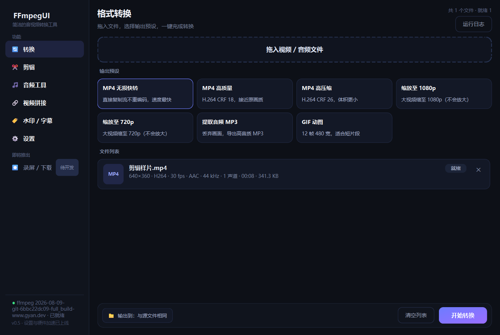
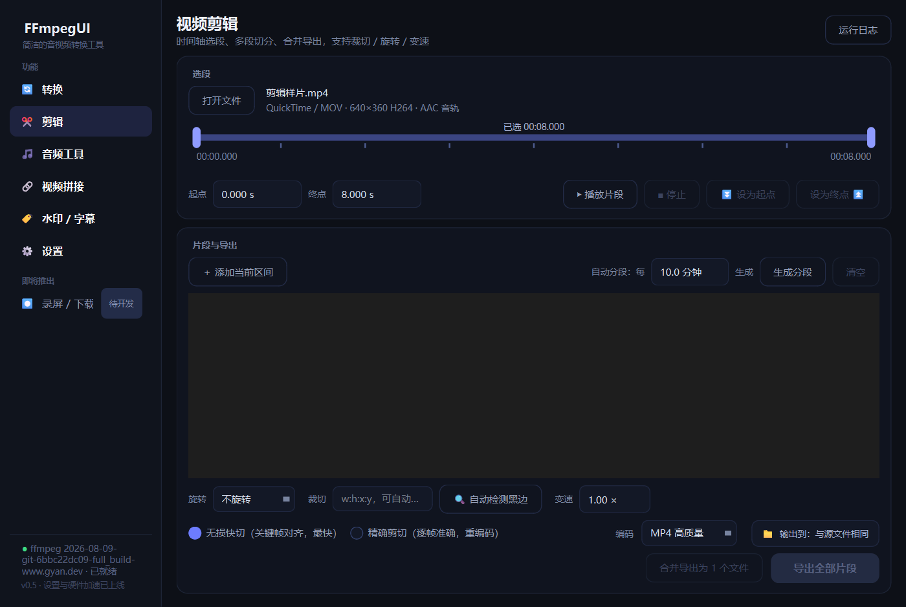

# FFmpegUI

简洁美观的 FFmpeg 图形界面工具（Python + PySide6 / Qt6，深色主题，中文界面）。

当前为 **v0.6**：转换支持高级自定义模式、一键预设，以及无界面 CLI / JSON / Python API；剪辑、音频、拼接、水印/字幕和设置六大模块可用，可打包为独立 exe 分发。

## 稳定性优化

- 同名文件并发输出使用独立临时文件，最终输出排他发布，不覆盖其他任务或已有文件
- 队列修复重试取消、启动期间取消、异常后卡住及 worker 退出时新任务无人处理；完成任务及时释放
- 缩放预设可组合旋转、裁切、变速、水印、字幕及拼接，统一构建滤镜链
- 有声/无声素材混合拼接为无声段补静音；快速拼接检查帧率、时间基、像素格式及声道
- 修复 AI 字幕 SRT 重编号，识别/下载支持取消；关闭窗口时回收进程并清理资源
- 默认目录修改即时生效并保留页面手选目录；过期的媒体探测结果不再覆盖当前文件
- 设置按字段校验并原子保存；启动脚本兼容 `py -3`；AMF 保留预设间量化等级差异

## 界面预览

**格式转换** —— 拖入文件、选择预设、一键批量转换：



**视频剪辑** —— 时间轴选段（关键帧刻度）、预览取点、多段切分与合并：



## 功能

### 设置与性能（v0.5）

- **设置页**：ffmpeg / ffprobe 路径自定义（带可用性测试）、默认输出目录（各页自动套用）、任务并发数（1-4）、恢复默认
- **GPU 硬件加速**：一键检测 NVENC / QSV / AMF（逐个试编码，防止"列表里有但驱动不可用"的误报），勾选后所有 H.264 重编码任务自动替换为硬件编码器（质量参数自动换算：NVENC `-cq`、QSV `-global_quality`、AMF CQP）；高级模式尊重显式编码选择
- **任务并发**：队列支持多 worker，认领机制防止重复执行；无损快转类任务可开高并发
- 设置持久化于 `%LOCALAPPDATA%\FFmpegUI\settings.json`，修改即时保存

### 打包分发（v0.5）

```bash
python -m pip install pyinstaller
python -m PyInstaller --noconfirm --clean FFmpegUI.spec
python tools/verify_bundle.py
```

产物在 `dist\FFmpegUI\`，包含 GUI `FFmpegUI.exe`、无界面 `FFmpegUI-cli.exe` 和共享运行时；整个文件夹拷给对方即可；
目标机器需已安装 FFmpeg 并加入 PATH（或用设置页指定路径）。
请使用仓库中的 spec 构建；其中包含未激活 Conda 环境的 Qt/Shiboken DLL 搜索路径修正。
`verify_bundle.py` 会在隔离配置和最小 PATH 下验证六个页面及高级模式启动，防止产物意外依赖开发环境。

### 水印 / 字幕（v0.4）

- **文字水印**：内容、字号、6 种预设色 + 自定义取色、不透明度、边距，九宫格快速定位
- **图片水印**：PNG/JPG 叠加，按视频宽度百分比缩放、不透明度、九宫格定位
- **字幕烧录**：SRT / ASS，四种样式预设（白字黑边 / 黄字黑边 / 底部大字 / 跟随字幕自带样式）
- **whisper AI 字幕**：本地识别语音直接生成 SRT（不上传网络），base / small 两档模型，一键下载（走 hf-mirror 镜像），生成后可直接烧录
- 中文文本经临时文件写入规避滤镜转义；水印文字自动描边保证可读性

### 音频工具（v0.3）

- 批量音频格式转换：MP3 320k / MP3 VBR / AAC (M4A) / FLAC 无损 / WAV / OGG / Opus 七种预设
- **音量归一化**：EBU R128 响度统一到 -16 LUFS，多平台发布音量一致
- **降噪**：afftdn 频域降噪，适合录音/语音素材
- 视频文件直接拖入即可提取音轨转换；与转换页体验一致（进度/取消/日志）

### 视频拼接（v0.3）

- 多文件**按顺序拼接**：列表支持上移/下移调整顺序，实时显示总时长
- **自动兼容性检查**：编码参数一致时显示绿色 ✓，走 concat 流复制（免转码秒级完成）
- 参数不一致（分辨率/编码/采样率不同）自动切换**重编码合并**：统一缩放加黑边到首个文件分辨率帧率，任意格式都能拼
- 文件名含中文、空格、引号均正确处理（concat 清单转义）

### 转换（v0.6）

- **常用预设 / 高级自定义** 两种模式，保留原有 7 个预设
- 高级模式按当前 FFmpeg 实际编译能力筛选常见输出格式和编码器；更改工具路径后重新检测
- 本机 FFmpeg 能力满足时可选 **19 种输出**：视频 MP4 / MKV / MOV / WebM / AVI / TS / FLV / MPG；音频 MP3 / M4A / AAC / FLAC / WAV / OGG / Opus / AIFF；动画 GIF / APNG / WebP
- 视频编码包括 H.264 / H.265 / AV1 / VP8 / VP9 / ProRes / FFV1 / MPEG 等，具体选择随本机编码器和容器兼容性变化
- 分别选择视频/音频编码、复制原流或禁用对应流；硬件编码器须先通过试编码
- 可调整画质、视频码率、宽高、帧率、音频码率、采样率、声道数；复制原流时禁用重编码参数
- 入队前检查整批文件的格式/编码兼容性和流需求，不会只入队半批；明确选择的软件编码不受全局 GPU 偏好替换
- 导入不再受扩展名白名单限制，由 ffprobe 检查内容；仅转换本地文件
- 高级模式仅输出第一条视频和第一条音轨，不保留字幕、附件或其他轨道；格式列表覆盖常见单文件输出，未将所有设备、网络、分段或测试用 muxer 开放为普通格式


- 拖入 / 点选批量添加视频、音频文件（支持中文与空格路径）
- 自动探测并展示媒体信息（ffprobe：编码、分辨率、帧率、时长、大小、音轨）
- 7 个开箱即用的输出预设：
  | 预设 | 说明 |
  |---|---|
  | MP4 无损快转 | `-c copy` 直接复制流，秒级完成 |
  | MP4 高质量 / 高压缩 | H.264 CRF 18 / 26 |
  | 缩放至 1080p / 720p | 只缩不放 |
  | 提取音频 MP3 | libmp3lame VBR 高音质 |
  | GIF 动图 | 12 帧 480 宽，自动调色板 |
- 实时进度条 + 转换速度，共享任务队列（设置中可选 1–4 并发）
- 取消任务 / 批量取消；运行日志面板
- 输出文件重名自动避让；临时文件 + 原子改名，中断不残留损坏文件
- 转换完成一键打开输出所在文件夹

### 剪辑（v0.2）

- **时间轴选段**：可视化轨道 + 双拖柄 + 关键帧刻度（大文件自动跳过刻度），起止点支持精确到毫秒
- **预览与取点**：ffplay 播放所选片段，播放中可一键"设为起点 / 设为终点"实时取点
- **多段切分**：手动添加区间，或"每 N 分钟"自动分段（最长录像归档友好）
- **两种导出模式**：
  - 无损快切：输入定位 + 流复制，秒级完成（切点对齐关键帧）
  - 精确剪切：逐帧准确，可选编码预设（高质量 / 高压缩 / 1080p / 720p）
- **片段合并**：多个片段合并导出为 1 个文件（单条 ffmpeg 命令，多输入 concat，无需中间文件）
- **画面处理**（精确模式）：旋转 / 翻转、画面裁切 + 黑边自动检测（cropdetect）、0.5–2.0× 变速（音频自动 atempo 补偿音调）
- 与转换页共用同一任务队列，进度 / 取消 / 日志体验一致

## 运行

```bash
# 1) 安装依赖（Anaconda 已自带 PySide6 时可跳过）
python -m pip install -r requirements.txt

# 2) 启动
python -m app.main
```

或直接双击 `启动FFmpegUI.bat`（首次会自动装依赖）。

前提：本机已安装 FFmpeg 并加入 PATH（`ffmpeg` / `ffprobe` 可用）。

## 命令行与 AI 调用

提供无界面的 `FFmpegUI-cli.exe`，与 GUI 一起位于 `dist/FFmpegUI`，支持 `formats`、`capabilities`、`probe`、`test-encoder`、`convert` 和 JSON `run` 请求。

```powershell
.\dist\FFmpegUI\FFmpegUI-cli.exe convert "C:\media\input.mp4" --format webm --video-encoder libvpx-vp9 --audio-encoder libopus --output-dir "C:\media\output" --json
python -m app.cli run --request job.json --json
```

stdout 默认输出一个 UTF-8 JSON 结果，`--progress` 将 NDJSON 进度写到 stderr；另提供不依赖 Qt 的 `app.api.execute()`。
参数、批处理、退出码、stdin JSON 及 Python/AI 调用示例见 [自动化文档](docs/automation.md)。

## 开发路线图（界面中「待开发」对应项）

| 版本 | 模块 | 内容 |
|---|---|---|
| v0.7 | 录屏 / 下载 | 桌面录制、直播流拉流 |
| 远期 | — | 任务历史、自定义预设保存、多语言 |

## 架构

```
app/
├── main.py              # 入口
├── cli.py               # 无界面命令行与 JSON stdin / 文件入口
├── api.py               # 不依赖 Qt 的同步 Python / JSON API
├── core/                # 与 UI 无关的核心层（可独立测试）
│   ├── presets.py       # 输出预设（纯数据）
│   ├── capabilities.py  # 本机输出格式/编码器检测与试编码
│   ├── conversion.py    # 高级转换格式、参数构建与兼容校验
│   ├── filters.py       # 组合预设与业务视频滤镜
│   ├── clipping.py      # 剪辑命令构建 + 关键帧/黑边探测
│   ├── audio.py         # 音频预设 + 归一化/降噪链
│   ├── merging.py       # 拼接：兼容性检查 + concat/重编码合并
│   ├── watermark.py     # 水印/字幕命令构建（临时文件规避转义）
│   ├── whisper.py       # AI 字幕：模型下载 + 识别生成 SRT
│   ├── gpu.py           # 硬件编码检测 + 参数替换
│   ├── settings.py      # 设置持久化（路径/输出目录/并发/GPU）
│   ├── probe.py         # ffprobe JSON 探测
│   ├── runner.py        # 任务构建 + ffmpeg 执行（进度/取消/临时文件/多输入）
│   └── queue.py         # 并发任务队列（后台线程、取消与关闭回收）
└── ui/
    ├── theme.py         # QSS 深色主题
    ├── main_window.py   # 主窗口 / 侧栏 / 页面栈 / 事件桥
    ├── advanced_conversion.py # 高级转换选项与后台能力检测
    ├── clip_page.py     # 剪辑页（时间轴控件、预览、片段列表）
    ├── audio_page.py    # 音频工具页
    ├── merge_page.py    # 视频拼接页
    ├── watermark_page.py # 水印/字幕页（含 AI 字幕）
    ├── settings_page.py  # 设置页（路径/并发/GPU 检测）
    ├── file_row.py      # 转换/音频页文件行控件
    └── widgets.py       # 共享控件（拖放区、预设卡片、默认目录）
test/run_all.py          # 隔离配置，统一执行回归与冒烟测试
test/test_*regressions.py # 队列/媒体/设置/真实 Qt 回归
test/smoke.py            # 转换核心冒烟测试
test/smoke_clip.py       # 剪辑核心冒烟测试
test/smoke_av.py         # 音频与拼接冒烟测试
test/smoke_wm.py         # 水印与字幕冒烟测试
test/smoke_settings.py   # 设置/GPU/并发冒烟测试
launch.py                # PyInstaller 打包入口
launch_cli.py            # 独立控制台程序打包入口
docs/automation.md       # CLI / JSON / Python 与 AI 调用文档
```

whisper 模型存放在 `%LOCALAPPDATA%\FFmpegUI\models`（base 148MB / small 445MB，
首次使用在界面内一键下载）。

关键实现：进度取自 `ffmpeg -progress pipe:1 -nostats` 的 `key=value` 输出；
输出先写带随机标识的 `*.ffgui-tmp.*` 临时文件、成功后排他发布；剪辑用输入侧 `-ss/-t` 快速定位，
合并为单条多输入命令；跨线程通过 Qt 信号回传 UI；预览解析 ffplay 状态行取实时进度。

## 开发与验证

```bash
python -m pip install -r requirements-dev.txt
python test/run_all.py
```

统一入口为测试设置独立的 `LOCALAPPDATA` 和离屏 Qt 环境，依次执行回归与原有五个冒烟脚本。
媒体测试需要本机 FFmpeg/ffprobe，水印测试需要相关滤镜；AI 推理在模型未下载时跳过，测试不会下载模型。
真实 Qt 回归需 PySide6；只运行标准库核心测试时可使用 `python -m unittest discover -s test -p "test_*regressions.py"`，缺少 Qt 的测试会明确跳过。

已验证环境：Windows、Python 3.13.9、PySide6 6.9.2；核心层另在 Python 3.12 上验证。

## 已知限制

- 无损快切对齐关键帧，需要精确切点时使用精确剪切
- 变速范围为 0.5–2.0×；暂不提供任意 FFmpeg 参数输入与自定义预设保存
- FFmpeg / ffprobe 需外部安装；预览需要 ffplay，支持 `FFPLAY_PATH`，默认优先查找配置的 FFmpeg 同目录
- AI 字幕需要支持 whisper 滤镜的 FFmpeg 和本地模型；模型下载取消会在当前网络读取返回后生效
- 硬件编码失败暂不自动回退 CPU；AMF 使用 CQP 表达预设质量差异，与 x264 CRF 不等价
- 多音轨选择、HDR/色彩管理、任务历史与断点恢复尚未提供
